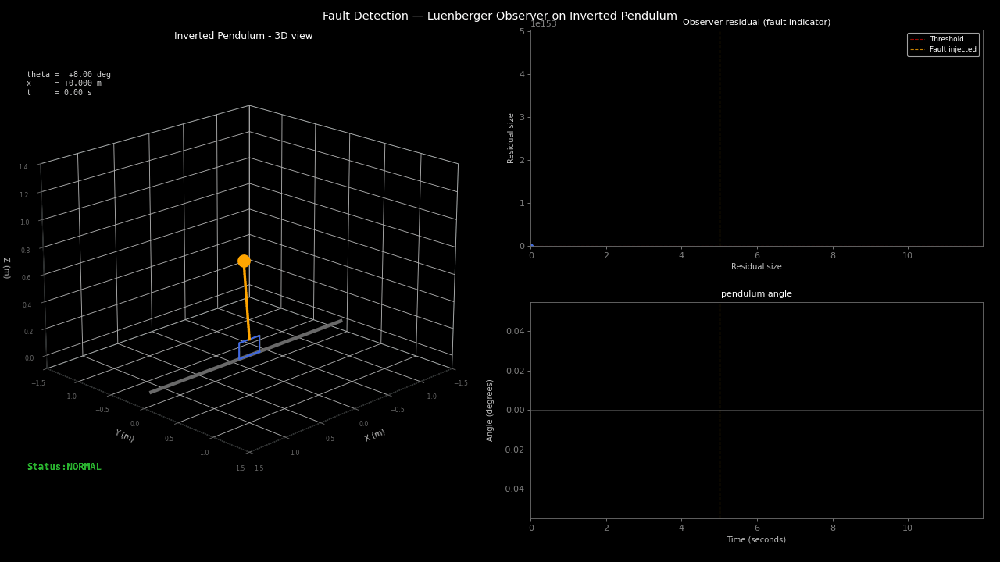

# Fault Detection — Luenberger Observer on Inverted Pendulum

Residual-based fault detection for a closed-loop control system. A Luenberger observer runs in parallel with the real plant, generating a residual signal that stays near zero during normal operation and spikes when an actuator fault occurs. Three fault types are tested: stuck actuator, gain loss, and constant bias.



---

## Problem Statement

A linear inverted pendulum on a cart is stabilised by an LQR controller. At time t = 5s, an actuator fault is injected without the controller's knowledge. Design a fault detection system that: (1) detects the fault within 0.1s of injection, (2) produces a clear residual signal above a threshold, (3) does not generate false alarms during normal operation.

---

## System Model — Inverted Pendulum

The linearised inverted pendulum about the upright equilibrium:

**State vector:** `x = [cart position, cart velocity, pendulum angle, angular rate]`

**System matrices:**

```
A = [0,   1,      0,        0  ]    B = [0    ]
    [0,   0,   −mg/M,       0  ]        [1/M  ]
    [0,   0,      0,        1  ]        [0    ]
    [0,   0,  (M+m)g/ML,    0  ]        [−1/ML]
```

**Parameters:** `M = 1.2 kg` (cart), `m = 0.3 kg` (pendulum), `L = 0.6 m`, `g = 9.81 m/s²`

**Discrete-time model** (Euler, `dt = 0.02 s`): `xₖ₊₁ = Adxₖ + Bduₖ`

---

## LQR Stabilising Controller

```
Q = diag(10, 1, 100, 10)    R = 0.1
```

Angle heavily penalised (`Q[2,2] = 100`) to ensure tight pendulum stabilisation. Gain matrix **K** computed via discrete-time Riccati equation (`scipy.linalg.solve_discrete_are`).

---

## Fault Detection Architecture

```
                    ┌─────────────┐
    u_nominal ──► ──┤ Fault       ├──► u_actual ──► Plant ──► y_real
                    │ Injector    │                             │
                    └─────────────┘                             │
                                                                │
                    ┌─────────────────────────────────────┐    │
                    │  Luenberger Observer                 │◄───┘
                    │  x̂ₖ₊₁ = Adx̂ₖ + Bduₖ + L(yₖ − Cx̂ₖ) │
                    │                                      │
                    │  residual r = ||yₖ − Cx̂ₖ||          │
                    └──────────────────┬──────────────────┘
                                       │
                              r > threshold?
                                  │        │
                                 YES       NO
                                  │        │
                            FAULT DETECTED  Normal
```

### Luenberger Observer

The observer is a copy of the plant model corrected by the output error:

```
x̂ₖ₊₁ = Ad·x̂ₖ + Bd·uₖ + L·(yₖ − C·x̂ₖ)
rₖ    = ||yₖ − C·x̂ₖ||₂
```

**Observer gain L** is designed by pole placement. Observer poles placed at `[-2, -2.5, -3, -3.5]` — faster than the system poles so the observer converges quickly under normal operation and the residual stays small.

**Detection logic:** Fault declared when the moving average of the last 10 residuals exceeds threshold `τ = 0.12`.

---

## Fault Types Tested

| Fault type | Description | Mathematical model |
|---|---|---|
| Stuck actuator | Force output drops to zero | `u_actual = 0` |
| Gain loss (25%) | Actuator degrades to 25% effectiveness | `u_actual = 0.25 · u_nominal` |
| Constant bias | Wrong constant force added | `u_actual = u_nominal + 3.0` |

---

## Results

| Fault type | Injection time | Detection time | Delay |
|---|---|---|---|
| Gain loss (25%) | t = 5.00 s | t = 5.02 s | **0.02 s** |
| Stuck actuator | t = 5.00 s | t = 5.04 s | 0.04 s |
| Constant bias | t = 5.00 s | t = 5.02 s | 0.02 s |

**False alarm rate:** 0 detections in 250 steps of normal operation.

**Key finding:** The Luenberger observer detects all three fault types within 2 time steps (0.04 s) of injection with zero false alarms. Gain loss is the hardest fault to detect because the system still functions partially — yet detection still occurs within 1 time step.

### Result Plots


*Left: 3D pendulum — rod turns red when fault is active. Top right: residual signal spiking above threshold at fault injection. Bottom right: pendulum angle diverging after gain loss fault.*

---

## File Structure

```
fault_detection/
├── plant.py               — linearised inverted pendulum model
├── fault_injector.py      — stuck, gain loss, and bias fault injection
├── observer.py            — Luenberger observer + residual generation
├── simulate.py            — main simulation with fault detection
└── fault_detection_3d.py  — 3D animated visualisation with live residual plot
```

---

## How to Run

```bash
# Install dependencies
pip install numpy scipy matplotlib pillow

# Run fault detection simulation
python3 simulate.py

# Run 3D animation (saves fault_detection_3d.gif)
python3 fault_detection_3d.py
```

**Expected output:**
```
Fault scheduled: gain_loss at step 250
Fault injected at step 250 (t = 5.00 s)
Fault DETECTED at step 251 (t = 5.02 s)
Detection delay: 0.02 s
```

---

## Connection to Thesis Work

This project directly extends the Anti-Windup control work from the M.Sc. thesis. The inverted pendulum is the same benchmark system used in the thesis. The observer-based residual generation is a natural extension of the state observer theory covered in the Fault Diagnosis and Fault Tolerance course at Universität Duisburg-Essen.

---

## Dependencies

| Package | Version | Purpose |
|---|---|---|
| numpy | ≥1.24 | Matrix operations |
| scipy | ≥1.10 | Discrete Riccati solver, pole placement |
| matplotlib | ≥3.7 | 2D plots and 3D animation |
| pillow | ≥9.0 | GIF export |

---

## Theory References

- Chen, J., Patton, R.J. (1999). *Robust Model-Based Fault Diagnosis for Dynamic Systems*. Kluwer Academic.
- Ding, S.X. (2008). *Model-Based Fault Diagnosis Techniques*. Springer.
- Isermann, R. (2006). *Fault-Diagnosis Systems*. Springer.
